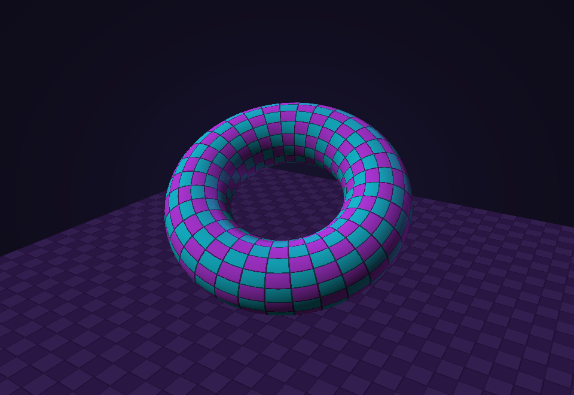
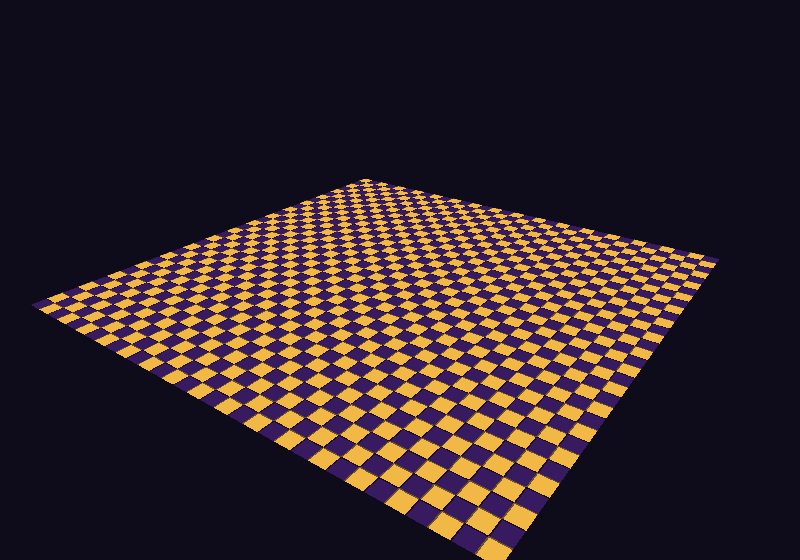

# Software rasterizer lab

A CPU triangle renderer implemented directly in Python/NumPy: **six-plane homogeneous clipping, top-left sample ownership, z-buffer visibility and perspective-correct UV interpolation**. Pillow writes the final pixels; no 3D graphics engine renders the scenes.



## Inspect the experiment

| Artifact | What it demonstrates |
|---|---|
| [Report](docs/report.html) | Side-by-side interpolation, clipping, coverage and depth; open locally |
| [Screenshot gallery](docs/screenshots/README.md) | Rendered report sections for direct GitHub review |
| [Recorded browser review](docs/recordings/README.md) | Capture provenance and navigation through the actual report |
| [Rendered turntable MP4](docs/recordings/turntable.mp4) | 48 actual CPU-rendered frames; a synthetic scene, not authoring footage |
| [Measured findings](results/findings.md) | Exact diagnostic counts and local timing interpretation |
| [Rasterizer source](src/rasterlab/core.py) | Transform matrices, clipping, edge functions, interpolation and depth test |
| [Procedural geometry](src/rasterlab/scenes.py) | Torus, ground plane, texture and model transform |
| [Design notes](docs/design.md) | Coordinate conventions, equations and pipeline choices |
| [Tests](tests) | Analytic clipping, shared-edge, ray/plane, UV, depth and artifact checks |
| [OBJ mesh](assets/torus.obj) / [texture](assets/checker.png) | Exported source geometry and checker image |

## The central comparison

| Affine screen-space UV | Perspective-correct UV |
|---|---|
|  |  |

Both images use identical mesh, camera and texture. Affine interpolation distorts the checker grid across the triangle diagonal. Perspective-correct interpolation blends attribute/w and 1/w, then divides. An independent ray/plane reference verifies actual pixel UV and depth values.

The shared-edge diagnostic partitions an exact 440 × 440 square into two triangles: **193,600 covered samples, zero samples covered twice**. This is a tested case, not a guarantee of fixed-point GPU-equivalent coverage for every floating-point mesh.

## Reproduce

Python 3.13 was used for the published run and CI:

```sh
python -m venv .venv
# Windows PowerShell: .venv\Scripts\Activate.ps1
# macOS/Linux: source .venv/bin/activate
python -m pip install -r requirements.txt
python -m unittest discover -s tests -v
python scripts/render_study.py --output-dir build/my-run
```

The separate output directory preserves the committed measurements. Omit `--output-dir` to replace generated assets, images, results and report with a new run. `--quick` reduces timing samples only; the diagnostic renders remain full size.

Optional actual-render movie generation requires FFmpeg on PATH:

```sh
python scripts/render_study.py --movie --output-dir build/my-run
```

The movie contains 48 frames at 12 fps and 640 × 420. A fixed camera observes one full model rotation. Temporary PNG frames stay under the ignored `build/` directory. [Turntable provenance](docs/recordings/turntable-provenance.json) records the rendering settings. Browser-review footage is a separate artifact.

## Implemented and measured

- Right-handed camera and perspective projection; clip against all six homogeneous planes before division.
- Attribute-preserving polygon clipping and fan triangulation.
- Pixel-center edge functions and top-left ownership; either triangle winding accepted.
- Float64 depth buffer, with affine interpolation of z/w and strict nearest-sample testing.
- Perspective-correct UV and normal interpolation, repeating nearest-neighbor texture sampling and approximate directional shading.
- Seven diagnostic/scene PNGs, source OBJ/texture, original clip coordinates, hashes and raw whole-frame timing samples.
- Fourteen tests, including independently derived ray intersections for covered pixels, invalid-input rejection and capture integrity.

The local timing measures complete 480 × 320 frame generation, including procedural geometry, clipping, rasterization and shading; image encoding is excluded. It is a Python CPU study, not a GPU benchmark or production performance claim. See [results](results/findings.md) and [protocol](docs/measurement.md).

## Limits and provenance

This is an **AI-assisted graphics portfolio project**. Geometry and textures are procedural, and the images/video are actual renderer outputs. No third-party scene assets or photos are used.

There is no GPU backend, native compilation, MSAA, mipmapping, bilinear filtering, transparency, shadow mapping or physically based lighting. Colors are shaded in display RGB rather than a linear-light pipeline. Nearest sampling visibly aliases; exact floating-point edge comparisons are not universally watertight. Equal-depth fragments keep the first submitted sample. The exported OBJ is an inspection artifact; an arbitrary OBJ importer is not implemented.
